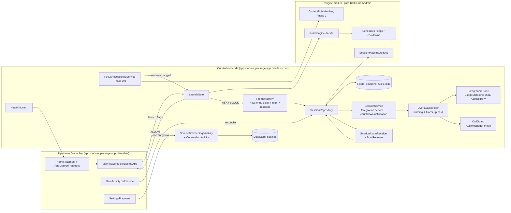
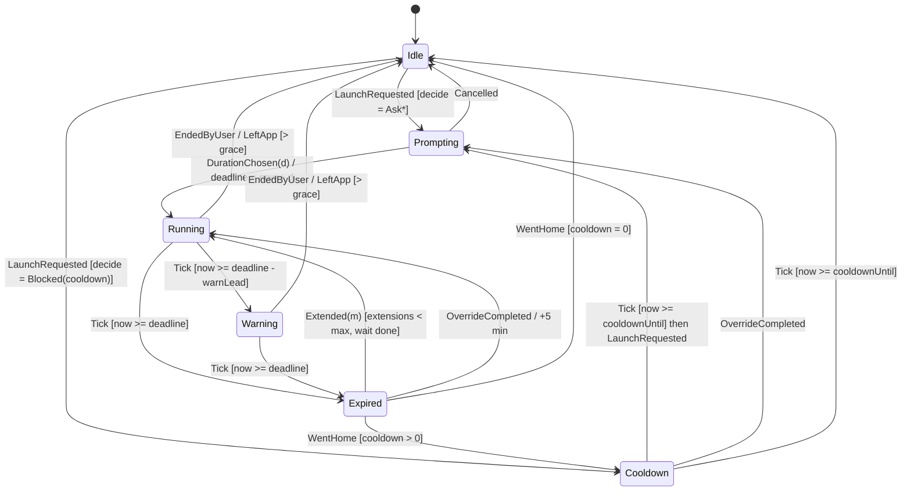
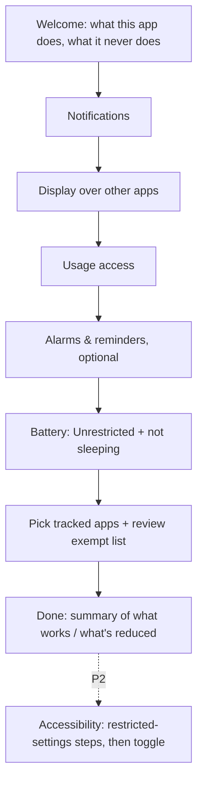

# Technical design: Calm Launcher

Status: draft v1, 2026-11-21. Inputs: [PRODUCT_REQUIREMENTS.md](PRODUCT_REQUIREMENTS.md),
[USER_STORIES.md](USER_STORIES.md), [CODEBASE_NOTES.md](CODEBASE_NOTES.md), the constitution.

Flags used throughout:
- ⚠️ **Android version**: behaviour differs by Android version.
- 🅢 **Samsung/OEM**: One UI-specific behaviour.
- 🅟 **Play policy**: fine for sideloading, but would need declarations or be refused on Google Play.

---

## 1. Architecture overview



Principles in one line each:
- The **engine decides**: a pure function of state, event, time and config.
- **Android adapters execute**: launch, show prompt, start service, set alarm, show overlay, go home.
- **Upstream calls in** through two one-line hooks: `selectedApp` and `onResume`.

## 2. Module and package structure

```
settings.gradle                 include ':app', ':engine'
engine/                         kotlin-jvm module, NO Android dependencies
  src/main/kotlin/app/calmlauncher/engine/
    Clock.kt                    interface Clock { fun now(): Long }; SystemClock impl lives in app
    model/                      AppKey, TrackedAppRule, Exemptions, Schedule, Config, SessionRecord
    RulesEngine.kt              decide(launch) -> Decision
    SessionMachine.kt           reduce(state, event) -> Transition(newState, effects)
    Schedules.kt, Caps.kt, Cooldowns.kt
    filter/                     (P3) NodeSnapshot, ContentRule, ContentRuleMatcher, RuleHealth
  src/test/kotlin/...           JUnit tests with FakeClock
app/src/main/java/app/olauncher/       upstream code (hooks only)
app/src/main/java/app/calmlauncher/    our Android code
  gate/LaunchGate.kt
  prompt/PromptActivity.kt
  session/SessionService.kt, SessionAlarmReceiver.kt, BootReceiver.kt, SessionRepository.kt
  enforce/OverlayController.kt, ForegroundProbe.kt, CallGuard.kt, GoHome.kt
  exempt/DefaultExemptions.kt
  data/CalmDatabase.kt, dao/*, entity/*, SettingsStore.kt
  settings/ScreenTimeSettingsActivity.kt
  onboarding/OnboardingActivity.kt, PermissionStatus.kt
  health/HealthMonitor.kt
  access/FocusAccessibilityService.kt      (P2)
  filter/AccessibilityNodeMapper.kt        (P3) AccessibilityNodeInfo -> engine NodeSnapshot
app/src/main/res/                         our layouts and strings prefixed calm_ (calm_prompt.xml, ...)
```

Decisions:
- **`:engine` is a separate Gradle module**, not just a package. The kotlin-jvm plugin makes it impossible to import `android.*`, so "pure Kotlin" is enforced by the compiler, and `./gradlew :engine:test` runs in seconds. Trade-off: one more `build.gradle`. The buildscript already has the Kotlin Gradle plugin on its classpath, so no new plugin repository is needed.
- **Our screens are Activities, not fragments in upstream's nav graph**, so `res/navigation/*.xml` is untouched. Trade-off: slightly more boilerplate per screen.
- **The Kotlin `namespace` stays `app.olauncher`** (the `R` class is unchanged); only `applicationId` changes. Our code lives under the `app.calmlauncher` source package and imports `app.olauncher.R`.
- No DI framework. A small `CalmGraph` object holds lazily created singletons (database, repository, settings).

### Upstream files modified (complete list; keep current)

| File | Phase | Change |
|---|---|---|
| `settings.gradle` | MVP | `include ':engine'` |
| `build.gradle` (root) | MVP | add KSP plugin classpath (for Room) |
| `gradle/libs.versions.toml` | MVP | add room, datastore, ksp, coroutines-test versions |
| `app/build.gradle` | MVP | `applicationId "app.calmlauncher"`, `implementation project(':engine')`, Room/DataStore deps, `apply plugin: 'com.google.devtools.ksp'` |
| `app/src/main/AndroidManifest.xml` | MVP | remove `INTERNET`; `android:label="@string/calm_app_name"`; add our permissions, activities, service, receivers |
| `app/src/main/res/xml/accessibility_service_config.xml` | MVP | `packageNames` → `app.calmlauncher.debug, app.calmlauncher` (keeps double-tap-to-lock working) |
| `app/src/main/java/app/olauncher/MainViewModel.kt` | MVP | in `selectedApp()`, the two launch branches call `LaunchGate.intercept(...)` first (≈6 lines) |
| `app/src/main/java/app/olauncher/MainActivity.kt` | MVP | `onResume()`: `CalmHooks.onLauncherResumed(this)` (1 line); new `onPause()` override calling `CalmHooks.onLauncherPaused(this)`; remove the two `setWallpaperWorker()` triggers (L192–194, L222) |
| `app/src/main/res/xml/data_extraction_rules.xml`, `app/src/main/res/xml/backup_rules.xml` | MVP | exclude `calm.db` and the `calm_settings` DataStore from cloud backup and device transfer |
| `app/src/main/java/app/olauncher/ui/SettingsFragment.kt` + `res/layout/fragment_settings.xml` + `res/layout-land/fragment_settings.xml` | MVP | add "Screen time" row; hide "Daily wallpaper" row and upstream promo links (`visibility="gone"`) |
| `app/src/main/res/layout/fragment_home.xml` + `ui/HomeFragment.kt` | MVP | one `TextView` for the health line; 3 lines to bind it; `changeAppTheme()` no longer schedules the wallpaper worker |
| `app/src/main/java/app/olauncher/helper/MyAccessibilityService.kt`, `helper/Utils.kt` (`isAccessServiceEnabled`) | P2 | merge into our service (see §3.3) |

Left untouched on purpose: `WallpaperWorker.kt` and the network helpers in `Utils.kt` become
unreachable dead code. Deleting them would cause merge conflicts on every upstream update.
Without `INTERNET`, any accidental call fails with a caught exception. A verification step
checks the merged manifest with `apkanalyzer manifest permissions`. WorkManager's merged
`ACCESS_NETWORK_STATE` permission is removed with `tools:node="remove"`.

## 3. Detecting and intercepting app launches

### 3.1 (a) Launcher-initiated launches: MVP

Every launch from home, swipe, drawer, search auto-launch and Enter passes through
`MainViewModel.selectedApp()` (CODEBASE_NOTES "How apps are launched"). The hook:

```kotlin
// MainViewModel.selectedApp(), FLAG_LAUNCH_APP / FLAG_HIDDEN_APPS branches (upstream edit)
if (LaunchGate.intercept(appContext, appModel)) return   // our code decides; true = handled
launchApp(...)   // unchanged upstream path
```

`LaunchGate.intercept` builds an `AppKey(package, userSerial)` and asks `RulesEngine.decide()`:
- `Allow` means return false, and upstream launches as before.
- `AskDuration`, `Delay`, `AskIntent`, `Blocked` or `ConfirmAgain` mean we start `PromptActivity` with `FLAG_ACTIVITY_NEW_TASK` and return true. After the user chooses, `PromptActivity` launches the app itself via `LauncherApps.startMainActivity` and starts the session.
- Any exception inside the gate is caught and returns false. This is the fail-open rule.

The prompt is its own Activity because the drawer pops its fragment right after calling
`selectedApp`, which would kill a fragment-owned dialog.

### 3.2 (b) Launches from outside the launcher: Phase 2

Notification taps, links, Recents, the share sheet and other apps never touch the launcher.

| | AccessibilityService (`TYPE_WINDOW_STATE_CHANGED`) | UsageStatsManager (`queryEvents`) |
|---|---|---|
| How it detects | System pushes an event with the package of the new foreground window | We **ask** for recent `ACTIVITY_RESUMED` events; there is no push callback |
| Latency | ~50–300 ms | Event appears after ~1–5 s; detecting it needs polling |
| Battery | Low if only window-state events are subscribed (a few per app switch) | Polling every 1–2 s while the screen is on costs real battery and breaks Principle V |
| Can act | Yes: `GLOBAL_ACTION_HOME`/`BACK`, accessibility overlay with no extra permission, exempt from background-activity-start limits | No; needs overlay permission plus activity starts |
| Permission | Accessibility toggle. ⚠️ Android 13+ "restricted settings" for sideloaded APKs. 🅟 Play restricts non-accessibility use | Usage access (special app-op), easy to grant. 🅟 Play requires justification |
| Reliability | 🅢 One UI may disable it after app updates or when "optimising"; the user can turn it off by accident | Robust and survives everything, but late |
| Privacy surface | Can read all screen content, so we must limit what we read and store | Package names and timestamps only |

**Recommendation:**
- **Primary (P2):** a single `FocusAccessibilityService` subscribed **only** to `typeWindowStateChanged`, with `canRetrieveWindowContent=false` until content filtering (P3) is turned on. When the foreground package is tracked, not exempt, and has no running session, it shows the prompt as an accessibility overlay on top of the app (US-B2). Cancel triggers `GLOBAL_ACTION_HOME`.
- **Secondary:** UsageStats, used **only as one-shot queries** at specific moments: deadline reached, launcher resumed, screen turned on. It answers "what is in front now?" and "how many unplanned opens today?". It works without accessibility, so the MVP uses it, and P2 keeps it as the fallback when the service is off.
- Reconcile by event: launcher `onResume`, `ACTION_SCREEN_ON`/`USER_PRESENT` receiver (registered at runtime by the service), alarm. No polling loops.

### 3.3 Upstream's existing accessibility service

Upstream's `MyAccessibilityService` (double-tap-to-lock) runs in a separate process
(`:serviceProcess`), only watches its own package, and writes SharedPreferences across processes.
Two accessibility toggles for one app would be confusing. In P2:
- the lock logic (5 lines) moves into `FocusAccessibilityService`, which runs in the **main process**
- the upstream `<service>` entry is removed from the manifest
- `isAccessServiceEnabled()` checks our class

These are the P2 upstream edits listed in §2.

## 4. Session engine (pure Kotlin)

### 4.1 State machine

One state per tracked app. Only one app can be in `Running`/`Warning` at a time, because a
phone has one foreground app.



- `Prompting` contains optional sub-steps `Delay(seconds)` → `Intent` → `Duration`, all P2 except Duration.
- `Expired` while `inCall == true` stays `Expired(deferred)` with the effect `DeferUntilCallEnds`.
- On reboot, the repository replays `Tick(now)` against the persisted state. A deadline in the past closes the session as `EXPIRED` at its deadline, with **no** UI effect.

```kotlin
// engine: simplified API
sealed interface SessionState { /* Idle, Prompting, Running(start, deadline, extensions), Warning, Expired, Cooldown(until) */ }
sealed interface SessionEvent { /* LaunchRequested, DurationChosen, Cancelled, Tick, LeftApp, EndedByUser, Extended, OverrideCompleted, WentHome, CallStateChanged */ }
sealed interface Effect { /* LaunchApp, ShowPrompt, StartCountdown(deadline), ScheduleAt(time, why), ShowWarning, ShowTimesUp, GoHome, StopCountdown, Log(record) */ }

data class Transition(val state: SessionState, val effects: List<Effect>)

object SessionMachine {
    fun reduce(state: SessionState, event: SessionEvent, now: Long, cfg: Config): Transition
}
```

Time is always passed in (`now`), never read inside the engine, so tests use fixed timestamps.

### 4.2 Rules engine

`RulesEngine.decide(app: AppKey, now: Long, cfg: Config, history: History): Decision` runs the
checks in this **fixed order**. The first match wins.

| # | Check | Result |
|---|---|---|
| 0 | Any exception, or missing data | `Allow` (fail open; logged) |
| 1 | App is exempt (default or user) | `Allow` |
| 2 | Enforcement paused (`pausedUntil > now`) | `Allow` |
| 3 | App not tracked | `Allow` |
| 4 | Session already running for this app | `Allow` (continue) |
| 5 | Inside an active schedule block or focus session (P2) | `Blocked(Schedule, until)` |
| 6 | Daily session count or minutes cap reached (P2) | `Blocked(Cap, untilMidnight)` |
| 7 | In cooldown (MVP: after an expired session; P2: after any session) | `Blocked(Cooldown, until)` |
| 8 | Last session ended < N min ago (P2) | `ConfirmAgain(lastSession)` |
| 9 | Launch delay > 0 (P2) | `Delay(seconds)`, then continue at 10 |
| 10 | Intent prompt on (P2) | `AskIntent`, then continue at 11 |
| 11 | Otherwise | `AskDuration(options)`. Options are filtered by the remaining daily minutes; the custom range is 1..min(60, remaining) |

Every `Blocked` result carries `overridable = true`. This is a constructor invariant in the engine,
not a flag set at the call site, which enforces Principle III by type.

**Schedules:** `Schedule(daysOfWeek: Set<DayOfWeek>, start: LocalTime, end: LocalTime, apps)`.
- Windows that cross midnight (23:00–07:00) are split into two intervals.
- The time zone is passed in through `Config`.
- DST: evaluated on local wall time with `java.time`, which is available on the JVM and on Android API 26+ (desugaring for API 24–25).

**Caps** are computed from `history` (today's session records), so "today" uses the same local-midnight function everywhere.

**Delayed loosening (F7):** `ConfigChange.isLoosening(old, new)` is a pure function. Loosening changes go to `pending_change` with `applyAt = now + 24h`.

## 5. Timer execution

| Option | Keeps time while the app is in front | Survives process death | Survives reboot | Doze / screen off | Battery | Verdict |
|---|---|---|---|---|---|---|
| Coroutine in ViewModel | Only while the launcher's UI process lives | ❌ | ❌ | ❌ | Low | Not enough alone |
| WorkManager | Minimum 15 min period, inexact | ✅ | ✅ | Deferred | Low | ❌ wrong tool for minutes-precision |
| AlarmManager exact (`setExactAndAllowWhileIdle`) | Fires at the deadline even if the process is dead | ✅ | Must be re-set at boot | ✅ fires in Doze (rate-limited) | Very low | Good backup. ⚠️ Android 12+ needs `SCHEDULE_EXACT_ALARM`, denied by default for new installs on Android 14+ |
| Foreground service + in-process `Handler`/coroutine delay | ✅ precise | Restarted (`START_STICKY`); state re-read | Restarted from `BOOT_COMPLETED` | Session means screen on, so no Doze | Low (no wake-ups; notification chronometer counts down by itself) | **Primary** |

**Decision:** deadline-based with three layers.
1. **Source of truth:** the persisted session row (`deadline_at`, wall-clock epoch ms) in Room.
2. **Primary timer:** `SessionService`, a foreground service. It exists only while a session runs (Principle V). It shows the countdown with `NotificationCompat.setUsesChronometer(true).setChronometerCountDown(true).setWhen(deadline)`, so the system animates the clock and the app never needs per-second updates. It schedules two in-process callbacks: warning and deadline.
   - ⚠️ Android 14+ requires `android:foregroundServiceType="specialUse"` plus a `PROPERTY_SPECIAL_USE_FGS_SUBTYPE` explanation. 🅟 Play reviews `specialUse`.
   - ⚠️ Android 12+ forbids starting a foreground service from the background, so the service is started from `PromptActivity`, which is in the foreground. Restarts from `BOOT_COMPLETED` are an allowed exemption. Android 15's boot restrictions do not cover `specialUse`; verify on the device.
3. **Backup:** an exact alarm at the deadline, if the permission is granted.
4. **Reconciliation** (`SessionRepository.reconcile(now)`) runs on launcher `onResume`, `BOOT_COMPLETED`, service restart, alarm, and screen-on. It feeds `Tick(now)` to the engine.

Behaviour summary:
- **Reboot:** `BootReceiver` (`RECEIVE_BOOT_COMPLETED`) calls reconcile. A future deadline restarts the service. A past deadline closes the session silently as `EXPIRED`. 🅢 One UI may delay boot broadcasts; launcher `onResume` after unlock covers it anyway.
- **Process death:** the service restarts sticky and reconciles. If the restart is blocked (🅢 deep sleep), the exact alarm fires. If both fail, the next launcher resume reconciles, and the health line says "Timer was interrupted".
- **Doze:** a running session implies the screen is on. If the screen turns off mid-session, the deadline is applied lazily on screen-on: no time's-up screen if the user isn't back in that app.
- **Clock changes:** the in-process timers use `SystemClock.elapsedRealtime()`. The persisted deadline is wall-clock. `ACTION_TIME_CHANGED` triggers reconcile. A manual clock change can move a deadline; that is accepted, not defended.
- **Leaving the app (MVP):** when the launcher resumes during a session, a grace timer (proposed 2 min) starts. Still home at the end ends the session as `LEFT_EARLY`. In P2 the accessibility service provides exact `LeftApp` and `ReturnedToApp` events.

## 6. Enforcement UI

| Option | Pros | Cons |
|---|---|---|
| Overlay window (`TYPE_APPLICATION_OVERLAY`, needs `SYSTEM_ALERT_WINDOW`) | Appears over the app instantly without changing tasks; can be small (warning pill) or full-screen (time's up); having a visible overlay window exempts us from background-activity-start limits when we then send the user home | Special permission; must be carefully removable; 🅟 restricted on Play; ⚠️ Android 12+ blocks touches through translucent overlays (fine; we want a solid card) |
| Activity started from background | Normal UI, Back handling for free | ⚠️ Android 10+ blocks background activity starts unless exempt; ⚠️ Android 14/15 tightened PendingIntent-based exemptions |
| Just send the user home (HOME intent) | Simplest, can't trap the user | Abrupt, no explanation, same background-start limits |
| Full-screen-intent notification | Allowed from background | ⚠️ Android 14+: `USE_FULL_SCREEN_INTENT` is limited to calling and alarm apps on Play; behaves like a heads-up when the screen is on |
| Accessibility overlay (`TYPE_ACCESSIBILITY_OVERLAY`, P2) | No overlay permission; the service can `GLOBAL_ACTION_HOME` directly | Needs the accessibility service on |

**Decision:**
- **Warning:** heads-up notification in the MVP; optional small overlay pill in P2.
- **Time's up (MVP):** full-screen opaque overlay card with "Go home" (default, large), "Extend" (after the wait), and "I really need this" (override).
  - "Go home" and Back remove the overlay and start the HOME intent, which resolves to our `MainActivity`. This is allowed because our overlay is visible.
  - In P2 the same card uses the accessibility overlay plus `GLOBAL_ACTION_HOME` when the service is on.
  - If overlay permission is missing, it falls back to a high-priority "Time's up" notification whose tap goes home. Never block.

**Not breaking the phone (enforced in `OverlayController`):**
1. Before showing anything, `ForegroundProbe` checks the tracked app is actually in front. MVP: a one-shot `UsageStatsManager.queryEvents` for the last 10 min. P2: accessibility. Another app or unknown means no overlay; the session ends silently (fail open).
2. `CallGuard`: `AudioManager.mode` in `MODE_IN_CALL`, `MODE_IN_COMMUNICATION` or `MODE_RINGTONE` defers all UI (needs no permission; covers VoIP).
3. Never over the lock screen (`KeyguardManager.isKeyguardLocked` means defer until `USER_PRESENT`).
4. **Watchdog:** any overlay removes itself after 120 s without interaction, leaving the user where they were (logged as `OVERLAY_TIMEOUT`). A bug can never leave a permanent cover.
5. The overlay always handles Back and Home (Home closes it via `ACTION_CLOSE_SYSTEM_DIALOGS` / `onConfigurationChanged` detection; and the launcher resume path removes any overlay).
6. **Loop guard:** more than 3 enforcement actions on the same app in 30 s disables enforcement for that app for 10 min and shows a health notice.

## 7. Grayscale and badges (P2)

- No public API lets a third-party app toggle system grayscale. The workable route: grant `WRITE_SECURE_SETTINGS` once via `adb shell pm grant app.calmlauncher android.permission.WRITE_SECURE_SETTINGS`, then write `accessibility_display_daltonizer_enabled=1` and `accessibility_display_daltonizer=0` (monochromacy). ⚠️ These are undocumented secure settings; 🅢 One UI honours them, but verify on the device. Fallback: open `Settings.ACTION_ACCESSIBILITY_SETTINGS`. 🅢 One UI also offers grayscale in *Modes and Routines*, which can be suggested in onboarding.
- Badges: the launcher shows none. System-wide badges are a One UI setting (*Notifications → Advanced settings → App icon badges*); we deep-link to notification settings. Hiding other apps' notification counts is not possible without a notification-listener, which is out of scope.

## 8. Content filtering (Phase 3, experimental)

### 8.1 What accessibility can and cannot do

The service can **read** another app's view tree as `AccessibilityNodeInfo`, which exposes:
- `viewIdResourceName` (for example `com.instagram.android:id/...`), only when `flagReportViewIds` is set
- `text`, `contentDescription`, `className`
- `isSelected`, `isVisibleToUser`, bounds

It can **act** through:
- `performGlobalAction(BACK | HOME)`
- `node.performAction(ACTION_CLICK | ACTION_SCROLL_FORWARD)`
- drawing accessibility overlays

It **cannot** remove, hide or restyle another app's views.

Fragility, stated plainly:
- Resource IDs in Instagram and Facebook are not a public contract and change between versions. Some views have no ID at all.
- Facebook's UI is largely custom-rendered: many nodes have only `contentDescription`, and its structure changes often.
- Text labels ("Suggested for you", "Sponsored") depend on language and wording, and get A/B tested.
- ⚠️ Android 14 added `accessibilityDataSensitive`. Apps *may* hide views from services that aren't true accessibility tools. We will not lie by declaring `isAccessibilityTool`.
- Each content event requires walking the tree, which costs CPU. It must be throttled and scoped to the filtered apps.

### 8.2 Resilient design

- **Rules as data:** versioned JSON shipped in `assets/rules/` and replaceable via file import (C5). No rule is hard-coded in Kotlin.
- **Multiple signals per rule:** a rule matches when **at least `minSignals`** of its signals match. Signals can be:
  - resource-ID suffix
  - content-description regex
  - text regex (with a language tag)
  - class name
  - structural signal (for example "bottom-tab with `selected=true` at index 3")
- **Presence anchor:** each rule set has an "anchor", for example the app's bottom navigation bar, used to tell "rule broken" apart from "surface not visited".
- **Health:**
  - If the anchor was seen in ≥10 sessions but the rule matched 0 times while the user plausibly visited the surface, the rule becomes `STALE`. Detecting that "plausible visit" through UsageStats activity class names is a heuristic.
  - If the rule fires its action and the surface is still detected after 3 attempts, it becomes `FAILING`.
  - Both states auto-disable the rule and show a home health line.
  - Evaluation exceptions disable the rule for the day.
- **Scoping:**
  - Content events (`typeWindowContentChanged`, `typeViewScrolled`) are added via `setServiceInfo` only while a filtered package is in front.
  - Events are coalesced with `notificationTimeout = 300 ms`.
  - The tree walk is depth-capped at 25 levels and node-capped at 400 nodes.
- **Pure matcher:** `AccessibilityNodeMapper` converts the live tree into an engine `NodeSnapshot` tree (id, class, desc, text, flags). `ContentRuleMatcher` is pure Kotlin, so captured fixtures (from `adb shell uiautomator dump`, with personal text removed) become JVM tests.
- **Privacy:** snapshots live in memory only. The debug-only "rule inspector" logs to logcat, never to disk.
- **Fallback ladder** per app: try the full rule set; if that fails, only "leave Reels"; if that fails, no filtering, with the tracked-app session timer still applying.

Example rule (illustrative IDs; the real ones are captured on the device during P3):

```json
{
  "schema": 1, "app": "com.instagram.android", "version": "2026-11-21", "lang": "en",
  "anchor": { "anyOf": [{ "idSuffix": "tab_bar" }, { "descRegex": "^(Home|Search and explore|Reels|Profile)$" }] },
  "rules": [
    { "id": "ig.reels.leave", "enabled": true, "minSignals": 2,
      "signals": [ { "idSuffix": "clips_viewer_view_pager" },
                   { "descRegex": "^Reels$", "selected": true },
                   { "className": "androidx.viewpager.widget.ViewPager", "within": "clips" } ],
      "action": { "type": "BACK", "notice": "Reels are off" }, "cooldownMs": 1500 },
    { "id": "ig.feed.suggested.count", "enabled": false, "minSignals": 1,
      "signals": [ { "textRegex": "^(Suggested for you|Sponsored)$" } ],
      "action": { "type": "COUNT_ONLY" } }
  ]
}
```

### 8.3 Alternative: mobile websites with content blocking

| | Native app + accessibility rules | Our own WebView with injected CSS/JS | Firefox for Android + uBlock Origin custom filters |
|---|---|---|---|
| Can *hide* suggested posts or Reels links | ❌ can only leave, scroll past or cover | ✅ via CSS | ✅ via cosmetic filters such as `instagram.com##a[href^="/reels/"]` |
| Fragility | High (IDs, text, layout) | High: Instagram/Facebook CSS class names are hashed and change on deploy; selectors by `href` or `aria-label` are more stable | Same as WebView, but filters are edited in the browser with no rebuild; community filter lists exist |
| Needs `INTERNET` in our app | No | **Yes; violates Principle I** | No (Firefox does the networking) |
| Login and security | App's own | We would handle the user's Facebook/Instagram credentials and cookies; logins in an embedded WebView are often challenged | Normal browser login |
| DMs / notifications | Full | Web DMs work on Instagram; Facebook web pushes Messenger; no push notifications | Same as WebView; web push possible in Firefox |
| Effort | Medium–high, ongoing | High | Low |

**Recommendation:**
1. **Do not build a WebView client.** It breaks the no-network principle and turns the launcher into a browser that holds credentials.
2. For the strongest "following only, no Reels" experience, use **Instagram/Facebook in Firefox with uBlock Origin custom filters**. Mark the native apps tracked with short presets (or schedule-blocked), and pin a "Instagram (web)" home shortcut. Zero code in this app; P3 can add a doc page with starter filters.
3. In the native apps, P3 implements only:
   - (a) leave Reels/Video surfaces (C2)
   - (b) a feed budget with a nudge to the Following/Friends feed (C3)
   - (c) count-only detection of suggested and sponsored items for stats

**Realistically achievable vs not:**

| Achievable (with maintenance) | Not realistically achievable |
|---|---|
| Detect "user is in Reels/Video tab" and navigate away | Hide individual suggested or sponsored posts inside the native app |
| Detect the home feed and apply a time budget | Reliably tell posts from followed vs not-followed accounts in Facebook's feed |
| Count "Suggested for you" / "Sponsored" labels in English | Language-independent text detection without per-language rules |
| Leave DMs, profiles and notifications untouched | Rules that survive app updates without maintenance |
| Auto-disable broken rules with a visible notice | Blocking in-app surfaces without accessibility |

## 9. Storage

**Decision:**
- **Room** (SQLite) holds relational and historical data: sessions, logs, rules, schedules, and pending changes. Queries for stats and caps are SQL; migrations are explicit.
- **Preferences DataStore** holds small settings, flows and atomic writes.

Upstream's `Prefs` (SharedPreferences) is left alone. Everything runs in the main process, since we avoid upstream's `:serviceProcess`. `android:allowBackup` stays upstream's value, but our database and DataStore files are excluded in `data_extraction_rules.xml` and `backup_rules.xml` (MVP edit), so nothing leaves the device through cloud backup.

```mermaid
erDiagram
  TRACKED_APP { string package PK; int userSerial PK; int launchDelaySec; bool intentPrompt; int cooldownMin; int maxSessionsDay; int maxMinutesDay; bool silent; string presetsCsv }
  EXEMPT_APP { string package PK; string source "DEFAULT|USER"; long addedAt }
  SESSION { long id PK; string package; int userSerial; long startedAt; long declaredMs; long deadlineAt; long endedAt "null = active"; string endReason; int extensions; long intentAnswerId }
  EVENT_LOG { long id PK; long at; string package; string type; string detail }
  INTENT_ANSWER { long id PK; string chip; string text }
  SCHEDULE { long id PK; string name; int daysMask; int startMin; int endMin; bool enabled }
  SCHEDULE_APP { long scheduleId FK; string package }
  PENDING_CHANGE { long id PK; long applyAt; string kind; string payloadJson }
  RULE_SET { string app PK; string version; string json; long importedAt; bool active }
  RULE_HEALTH { string ruleId PK; string state; long lastMatchedAt; int anchorSessionsWithoutMatch }
  SESSION ||--o| INTENT_ANSWER : has
  SCHEDULE ||--o{ SCHEDULE_APP : covers
```

- `EVENT_LOG.type` values: `PROMPT_CANCELLED`, `EXTENDED`, `OVERRIDE`, `UNPLANNED_OPEN`, `OVERLAY_TIMEOUT`, `RULE_FIRED`, `RULE_STALE`, `SERVICE_INTERRUPTED`, `LOOP_GUARD`.
- `SESSION.endReason` values: `EXPIRED`, `ENDED_BY_USER`, `LEFT_EARLY`, `CANCELLED`, `INTERRUPTED`.
- At most one `SESSION` row has `endedAt IS NULL`. The repository enforces this inside a transaction.
- DataStore keys: `warningLeadSec` (60), `extensionWaitSec` (15), `maxExtensions` (2), `overrideWaitSec` (30, min 10), `graceSec` (120), `pausedUntil`, `onboardingVersion`, `grayscaleSchedule`.
- MVP uses `TRACKED_APP` (presets only), `EXEMPT_APP`, `SESSION` and `EVENT_LOG`. Other tables arrive with their phase, each through a Room migration.

## 10. Permissions

| Permission / access | Why | Phase | How granted | Flags |
|---|---|---|---|---|
| ~~`INTERNET`~~ | **Removed** (privacy) | MVP | none | |
| `QUERY_ALL_PACKAGES` (upstream) | List all apps | exists | install-time | 🅟 restricted on Play |
| `POST_NOTIFICATIONS` | Countdown, warning, time's-up fallback | MVP | runtime dialog | ⚠️ Android 13+ |
| `FOREGROUND_SERVICE`, `FOREGROUND_SERVICE_SPECIAL_USE` | Session timer service | MVP | install-time | ⚠️ type required on Android 14+; 🅟 `specialUse` reviewed |
| `SYSTEM_ALERT_WINDOW` ("Display over other apps") | Time's-up card over the app; background-start exemption to go home | MVP | Settings screen (`ACTION_MANAGE_OVERLAY_PERMISSION`) | 🅟 restricted; ⚠️ 12+ untrusted-touch rules |
| `PACKAGE_USAGE_STATS` (upstream) | One-shot "what's in front", unplanned-open stats, baseline | MVP | Usage access screen | 🅟 needs justification |
| `SCHEDULE_EXACT_ALARM` | Backup deadline alarm | MVP (optional) | "Alarms & reminders" screen | ⚠️ 12+; denied by default 14+. Don't use `USE_EXACT_ALARM` (🅟 alarm apps only) |
| `RECEIVE_BOOT_COMPLETED` | Restore session after reboot | MVP | install-time | 🅢 boot broadcasts may be delayed |
| Battery "Unrestricted" (`REQUEST_IGNORE_BATTERY_OPTIMIZATIONS` intent) | Keep timer and service alive | MVP | system dialog, plus One UI *Battery → Unrestricted*, plus off the *Sleeping apps* list | 🅟 restricted; 🅢 essential on Samsung |
| `BIND_ACCESSIBILITY_SERVICE` (service declaration) | Outside-launcher interception (P2), content filter (P3), lock (upstream) | P2 | Accessibility settings | ⚠️ 13+ restricted settings for sideloaded APKs; 🅟 strict policy; 🅢 may be auto-disabled |
| `WRITE_SECURE_SETTINGS` | Grayscale toggle | P2 | `adb shell pm grant` only | not grantable on-device |
| `ACCESS_NETWORK_STATE` (merged from WorkManager) | Not needed | MVP | removed via `tools:node="remove"` | |

**Onboarding flow** (`OnboardingActivity`, also reachable from settings as "Permissions status"):



- Each page has: one sentence of *why*, one sentence of *what is reduced if skipped*, a button that deep-links to the exact setting, and a live ✓/✗ refreshed in `onResume`.
- Every page can be skipped.
- `HealthMonitor` turns missing permissions into the single home health line.

## 11. Safety and override mechanics

1. **Exemptions first.** `DefaultExemptions` resolves the current holders of:
   - `RoleManager.ROLE_DIALER` and `ROLE_SMS` (API 29+; `resolveActivity` for `ACTION_DIAL` and `sms:` below that)
   - the `geo:` handler, `MediaStore.ACTION_IMAGE_CAPTURE`, `AlarmClock.ACTION_SHOW_ALARMS`, and `com.android.settings`
   - the user's additions (bank, authenticator, WhatsApp)

   They are re-resolved when packages change. The rules engine checks exemptions before anything else, with unit tests per rule type.
2. **Fail open everywhere.** `LaunchGate`, `OverlayController`, the service and the alarm receiver wrap their bodies in `failOpen { }`. It catches `Throwable`, logs `EVENT_LOG(type=ERROR)`, and returns the "allow / do nothing" result.
3. **Override:**
   - "I really need this" is on every block and time's-up screen.
   - It runs a 30 s countdown that resets on `onPause` or when the overlay loses visibility.
   - It always ends in success (opening the app with a 5-min session), is logged, and can't be disabled. The minimum of 10 s is enforced in `Config` validation.
4. **Calls and keyguard:** see §6 (`CallGuard`, keyguard check).
5. **Escape hatches,** documented in DEV_SETUP:
   - Android Settings → Default apps → Home app switches the launcher; it's always reachable via the notification shade gear.
   - `adb uninstall app.calmlauncher`
   - Samsung safe mode (hold *Safe mode* on the power-off menu) disables all third-party apps.
   - "Pause all for 1 h" behind the override (P2).
6. **Delayed loosening** (P2) makes the safe direction (tightening) instant and the unsafe one slow. It never applies to the override itself.

## 12. Testing strategy

| Layer | What | How | Phase |
|---|---|---|---|
| `:engine` unit | Every state transition; rules order; exemptions beat every rule; caps, cooldowns, schedules incl. midnight/DST; fail-open on bad config; loosening detection | JUnit 4 (already in upstream) + `FakeClock`; table-driven cases; run with `./gradlew :engine:test` | MVP→ |
| `:engine` content matcher | Rules vs captured `NodeSnapshot` fixtures (JSON, no personal text) | JUnit; fixtures per app version; a failing fixture means the rule needs updating | P3 |
| App unit (JVM) | `LaunchGate` decision mapping; `DefaultExemptions` intent resolution; `ConfigChange` serialization | Plain JUnit with small fakes for Android interfaces; no Robolectric unless unavoidable | MVP |
| Instrumented (device) | Room DAO + migrations (in-memory DB); `SessionService` start/stop | `./gradlew connectedDebugAndroidTest` with the phone attached | MVP (minimal) |
| Manual device script | Reboot mid-session, process kill, Doze, call during expiry, permission revoked | Checklist in `docs/DEVICE_TESTS.md` (created in implementation) using `adb shell am kill`, `adb reboot`, `adb shell dumpsys deviceidle force-idle`, `adb shell dumpsys alarm`, `adb shell appops set <pkg> SYSTEM_ALERT_WINDOW deny` | MVP→ |

Coverage goal: 100% of engine transitions and rule-order branches. No coverage target on Android adapters.

## 13. Build and dev workflow

- Build, test and install commands are in DEV_SETUP: `./gradlew assembleDebug test`, `adb install -r`, `adb logcat`, with JDK 17.
- Loop: write or adjust the engine test, then `./gradlew :engine:test` (seconds). Wire the adapter, then `assembleDebug`, `adb install -r`, and the manual check.
- Log tag `CalmLauncher` for our code; debug builds only log rule inspector output.
- Upstream sync: `git fetch upstream && git merge upstream/master` into `master`, then into feature branches. Conflicts are expected only in the files in §2's table.
- Optional (COULD): GitHub Actions running `./gradlew test assembleDebug` on push; this is CI only and doesn't affect the app's no-network rule.

## 14. Phased roadmap

| Phase | Scope | Exit criteria |
|---|---|---|
| **MVP** | Fork identity, `INTERNET` removed; `:engine` with session machine + rules (exempt, tracked, running, post-expiry cooldown); launcher hook; `PromptActivity` (How long?); `SessionService` with countdown notification; warning; time's-up overlay with soft extension + override; call/keyguard guards; reboot/kill reconciliation; Room (tracked, exempt, session, log); settings + onboarding; health line | US-L1, L2, T1–T8, F3 (post-expiry), B1, B6, B7 (expiry + cooldown), S1, X1, X3 pass on the Samsung phone; engine tests green; manual device script passes |
| **Phase 2** | `FocusAccessibilityService` (window events; merge upstream lock service); outside-launcher interception; schedules, focus sessions, caps, cooldown, launch delay, intent prompt, "one more?", nudges; delayed loosening; pause-all; grayscale; basic stats list | US-B2–B5, F1–F6, L3, L4, X2, X4 |
| **Phase 3** | Content filtering (Instagram, Facebook): JSON rules, matcher, health, fallback ladder; scrolling nudge; stats screen, time-saved, export; Firefox + uBlock filter guide | US-C1–C4, S2, F5.2 |

## 15. Version, OEM and policy watch list

- ⚠️ **Android 10+** background activity starts: mitigated by overlay visibility and the accessibility service.
- ⚠️ **Android 12+**: exact alarm permission; foreground service start restrictions; untrusted touch rules for overlays.
- ⚠️ **Android 13+**: notification runtime permission; restricted settings for sideloaded accessibility.
- ⚠️ **Android 14+**: foreground service types; exact alarms denied by default; `accessibilityDataSensitive`; full-screen-intent limits.
- ⚠️ **Android 15+**: tighter background-start and `BOOT_COMPLETED` foreground service rules; Private Space (upstream already handles listing it, and Private Space apps follow the same rules).
- 🅢 **One UI**:
  - Sleeping / Deep sleeping apps
  - "Put unused apps to sleep"
  - Battery "Optimised" kills foreground services and alarms
  - accessibility may be switched off after updates
  - boot broadcast delays
- 🅟 **Play** (not targeted): AccessibilityService for non-assistive use, `QUERY_ALL_PACKAGES`, `SYSTEM_ALERT_WINDOW`, `PACKAGE_USAGE_STATS`, `REQUEST_IGNORE_BATTERY_OPTIMIZATIONS`, `specialUse` foreground service.
- **Sideloading policy:** Google's developer-verification requirement for sideloaded apps is rolling out from 2026. Check its current status before each phase. `adb install` is the documented path.
